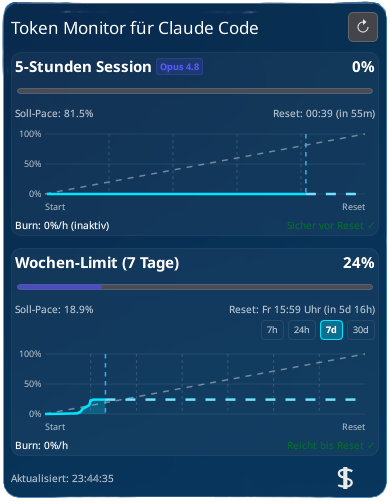
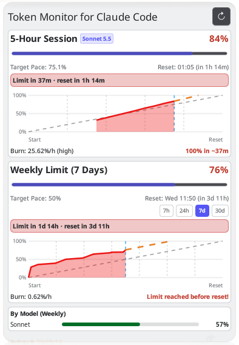
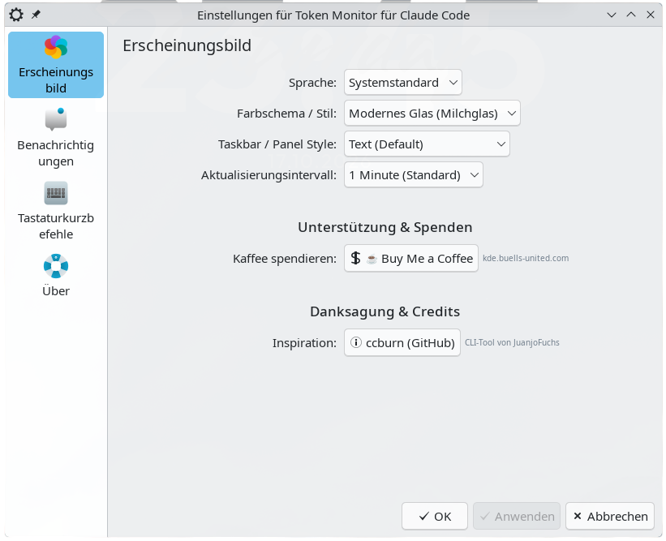

# Token Monitor for Claude Code

[](https://kde.org)
[](https://python.org)
[](package/metadata.json)
[](LICENSE)
[](#)
[-success?style=flat-square)](#)
[](#)
[](CONTRIBUTING.md)
[](SECURITY.md)
[](https://buymeacoffee.com/buellsunited)

[🇩🇪 Zur deutschen Anleitung wechseln (Switch to German README)](README.de.md)


KDE Plasma 6 Widget and Python backend for monitoring **Claude Code Token Limits, Burn Rate & Budget Pace** (natively integrated into your KDE Plasma panel and desktop).

---

## Screenshots

| Modern Glass (Frosted) | Breeze Dark | Settings & Appearance |
| :---: | :---: | :---: |
|  |  |  |

---

## Features

- **Native KDE Plasma 6 Widget** (Panel & Desktop):
  - **Bilingual (i18n)**: English (Default) & German via GNU Gettext / KI18n.
  - **In-App Language Switcher**: Switch between *System Default*, *English*, and *Deutsch* directly in widget settings.
  - **Dual Display Modes (Panel & Desktop)**:
    - **Compact Panel Mode (`compactRepresentation`)**: Docks into horizontal or vertical KDE Plasma panels with high-contrast color indicators (Green / Amber / Red) for 5-hour session and 7-day weekly limits.
    - **Interactive Popup**: Clicking the panel applet opens the full detailed monitor dashboard as a native Plasma popup.
    - **Desktop Widget Mode**: Resizable standalone widget on your Plasma desktop canvas (`fullRepresentation`).
  - **Comprehensive Quota Dashboard**: Real-time progress bars, exact reset countdowns, target pace comparison, burn rate (%/hour), and exhaustion estimation (ETA).
  - **Interactive Multi-Window Burn Charts**: Visual burn curve and linear projection towards limit or window reset, with switchable lookback timeframes (**7h**, **24h**, **7d**, and a **30d** history view spanning multiple weekly reset cycles).
  - **Rate Limit Resilience & Feedback**: Real-time HTTP 429 warning banner with active cooldown timer, automatic backoff, and one-click manual retry button (`🔄`) to immediately bypass cooldowns.
  - **Customizable Appearance**: Plasma theme matching, Breeze Light, Breeze Dark, transparent, or Modern Glass (frosted) mode with adjustable update intervals (15s to 5m).
- **Python Backend (Zero dependencies beyond Python 3 standard library)**:
  - **CLI & VS Code Extension Support**: Automatically detects active Claude Code sessions in terminal as well as the official VS Code Extension (`anthropic.claude-code`).
  - **Process-Aware API Polling**: Detects active Claude Code processes via `/proc`; pauses external API polling while idle and reports `0.0%/h (idle)` to avoid unwanted rate limits.
  - **Rate Limit Backoff & Safeguards**: Automatically respects Anthropic's HTTP 429 `Retry-After` headers and enforces a 3-minute minimum interval (180s) between API polls.
  - **OAuth Usage API Client**: Queries `https://api.anthropic.com/api/oauth/usage` using bearer token from `~/.claude/.credentials.json`.
  - **SQLite Snapshot History**: Persists snapshots for trend analysis in `~/.local/share/token-monitor/history.db`.
  - **Mathematical Analysis**: Linear regression (least squares) for burn rate (%/h), pace, and ETA calculations.
  - **Local HTTP Server**: Lightweight REST endpoint (`127.0.0.1:48291/stats`) with TTL caching to avoid unnecessary API requests.
  - **Zero-API Statusline Pipeline**: Hooks transparently into Claude Code's `statusLine` command (`~/.claude/settings.json`) as a Unix passthrough filter for CLI usage.

---

## Installation & Setup

### Automated Setup (Recommended)

```bash
./install.sh
```
This script compiles translations, installs the plasmoid into `~/.local/share/plasma/plasmoids/com.buellsunited.TokenMonitor`, installs backend files to `~/.local/share/token-monitor/`, and enables the systemd user service.

To also integrate the optional zero-API statusline hook into `~/.claude/settings.json`:
```bash
./install.sh --with-hook
```

### Manual Widget Installation

```bash
./install_widget.sh
```

After installation, add **"Token Monitor for Claude Code"** (or **"Token Monitor für Claude Code"** on German systems) to your KDE Plasma panel or desktop via the Widget Explorer.

### Starting the Backend Daemon

**Manually in Terminal:**
```bash
python3 -m backend.cli serve --port 48291
```

**Or enable as a systemd User Service:**
```bash
mkdir -p ~/.config/systemd/user/
cp token-monitor.service ~/.config/systemd/user/
systemctl --user daemon-reload
systemctl --user enable --now token-monitor.service
```

Check status:
```bash
systemctl --user status token-monitor.service
```

---

## Localization & Internationalization (i18n)

English is the primary source language. German translations are provided and built using GNU Gettext and KDE KI18n:

- Update template and compile catalogs:
```bash
./build_translations.sh
```
- Translation catalogs reside in `po/de.po` and compile to `package/contents/locale/de/LC_MESSAGES/plasma_applet_com.buellsunited.TokenMonitor.mo`.

---

## CLI Usage

Display current status as JSON in the terminal:
```bash
python3 -m backend.cli status
```

Pipe statusline JSON passively into collector:
```bash
echo '{"rate_limits": {...}}' | python3 -m backend.cli collect
```

---

## Testing & UI Simulation

Run unit tests (19 test cases, 100% standard library):
```bash
python3 -m unittest discover tests
```

Simulate UI states and test scenarios without using real tokens (`manage_fake_data.py`):
```bash
# Inject moderate usage test data
python3 scripts/manage_fake_data.py --inject

# Inject critical burn rate and high usage warning
python3 scripts/manage_fake_data.py --high

# Simulate active HTTP 429 rate limit (120s cooldown banner)
python3 scripts/manage_fake_data.py --rate-limit 120

# End rate limit simulation immediately
python3 scripts/manage_fake_data.py --clear-rate-limit

# Restore original database and exit simulation
python3 scripts/manage_fake_data.py --restore
```

---

## Support & Donations

If you find this widget useful and want to support continued development, consider buying a coffee!

[](https://buymeacoffee.com/buellsunited)

- **Website**: [kde.buells-united.com](https://kde.buells-united.com)
- **Donations**: [buymeacoffee.com/buellsunited](https://buymeacoffee.com/buellsunited)

---

## Contributing

Contributions, bug reports, and feature requests are very welcome! Please check out [CONTRIBUTING.md](CONTRIBUTING.md) for guidelines on local development setup, running tests, and pull request procedures.

All participants are expected to follow our [Code of Conduct](CODE_OF_CONDUCT.md).

---

## Security

Security and privacy are core priorities of this project. For vulnerability disclosure procedures and details on local-first security hardening, see [SECURITY.md](SECURITY.md).

---

## Acknowledgments

Inspired by [ccburn](https://github.com/JuanjoFuchs/ccburn) by JuanjoFuchs.

---

## License

This project is licensed under the GNU General Public License v3.0 - see the [LICENSE](LICENSE) file for details.

---

## Disclaimer

This is an unofficial community project and is not affiliated with, endorsed by, or sponsored by Anthropic PBC or KDE e.V. "Claude" is a trademark of Anthropic PBC. "KDE" and "KDE Plasma" are trademarks of KDE e.V.


